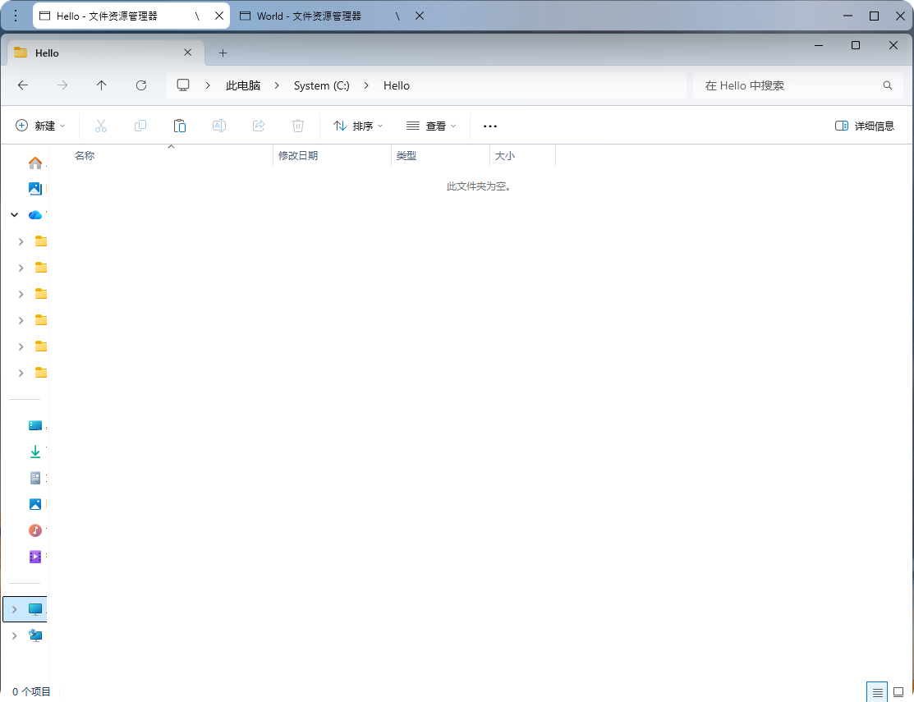
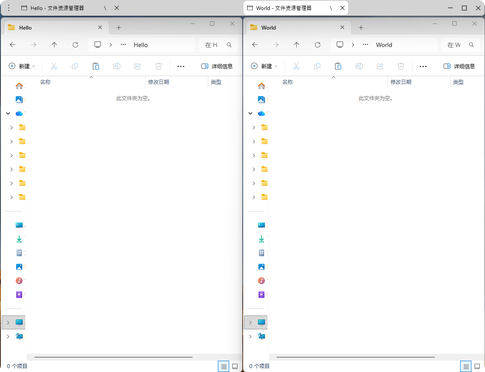
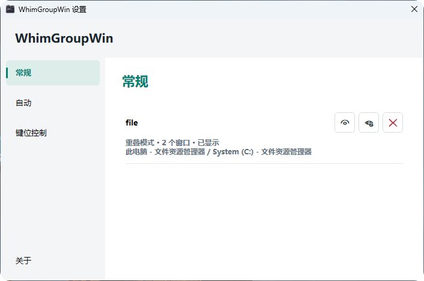
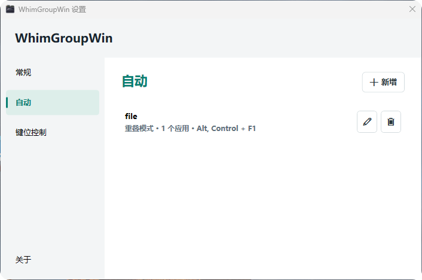
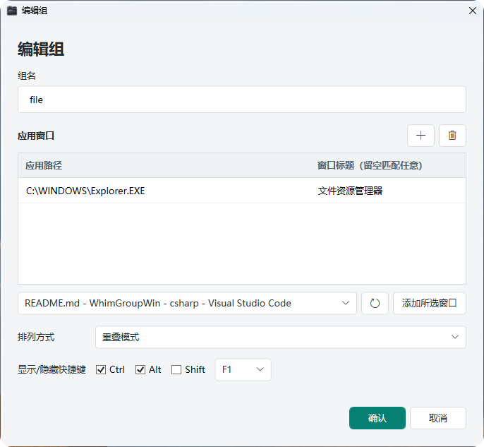

# WhimGroupWin


基于 .NET 10 和 WPF 的 Windows 窗口分组工具。通过独立的组合标题栏，将多个应用窗口组合在一起，支持标签切换、左右分屏、同步移动及自动组合。

项目地址：https://github.com/whim0w0/WhimGroupWin

## 界面预览

### 重叠模式



### 左右分屏



### 窗口组管理



### 自动组合





## 主要功能

- **手动组合**：按住组合修饰键拖动窗口，将窗口或已有组合并入目标组合。
- **重叠模式**：成员共享位置和尺寸，仅显示当前选中的窗口，通过标签快速切换。
- **左右分屏**：同时显示左右两侧窗口，每侧可容纳多个成员；支持继续拖入窗口，按落点加入对应侧。
- **组合操作**：同步移动、调整尺寸，支持整组最小化、最大化与还原。
- **移出与关闭**：标签中的 `\` 将窗口移出组合，`×` 请求关闭该窗口；组合栏右侧关闭按钮请求关闭全部成员。
- **窗口组管理**：“常规”页列出当前组合，提供显示、隐藏和关闭操作。
- **自动组合**：按应用路径及可选窗口标题匹配已运行的窗口，支持为每个自动组设置显示/隐藏快捷键。
- **快捷键设置**：可修改组合修饰键和成员切换快捷键，保存后立即生效。
- **托盘运行**：启动后常驻系统托盘，双击托盘图标打开设置。

工具不使用 `SetParent` 嵌入外部窗口，不修改成员窗口样式，也不向目标进程注入代码。成员保留各自的标题栏与独立窗口句柄。

## 快速使用

1. 启动程序，双击托盘图标，或通过托盘右键菜单打开“设置”。
2. 默认按住 **Ctrl + Alt**，用鼠标左键拖动一个窗口，在另一个窗口区域松开以创建组合。
3. 点击组合标签切换窗口；默认使用 **Shift + Tab** 按标签顺序向前循环切换成员。
4. 点击组合栏左侧的更多操作按钮，选择“左右分屏”；进入分屏后，同一菜单项变为“重叠模式”，可切回。
5. 在设置的“常规”页管理当前组合，或在“自动”页创建自动组合规则。

组合修饰键需要在开始拖动前按住。拖动已有组合的成员到其他窗口或组合时，源组全部成员会一起并入目标组。

### 自动组合规则

在“自动”页新增组，设置组名、应用窗口规则、排列方式和显示/隐藏快捷键：

- 可以浏览可执行文件，也可以从当前运行的窗口中添加规则。
- 窗口标题留空表示匹配该应用的窗口；填写时使用不区分大小写的包含匹配。
- 至少匹配两个可用窗口时建立组合，后续匹配窗口继续加入。
- 自动组合只匹配已运行的窗口，不负责启动应用，也不会抢占其他组合的成员。
- 手动移出的窗口在本次程序运行期间不会再次被自动加入。

### 关闭与退出

- **关闭窗口组**：向组内应用发送关闭请求，应用仍可弹出保存提示或取消关闭。左右分屏组关闭前会恢复成员进入分屏前的尺寸。
- **关闭设置窗口**：仅关闭设置界面，程序继续在托盘运行。
- **托盘菜单“关闭”**：退出本工具并解散组合、恢复显示成员，不主动关闭成员应用。

## 运行与构建

需要 Windows 桌面环境。源码构建需要 **.NET 10 SDK**；运行非自包含构建需要对应架构的 **.NET 10 Desktop Runtime**。

在项目根目录执行：

```powershell
dotnet build .\WhimGroupWin.csproj
dotnet run --project .\WhimGroupWin.csproj
```

使用 [publish.bat](publish.bat) 发布 Windows x64 自包含便携版本：

```bat
publish.bat
```

输出到 `publish\win-x64-portable`，外层为 `WhimGroupWin.exe`，应用程序集和 .NET / WPF 运行库位于 `runtime` 子目录。分发时需要保留整个目录，无需安装 .NET，运行时不提取运行库。发布不启用单文件、压缩或裁剪。

发布后运行外层的 `WhimGroupWin.exe`。程序采用单实例运行方式，重复启动不会创建第二个实例。

## 配置存储

配置保存在 EXE 所在目录，与启动时的工作目录无关；保存设置或规则时生成对应 JSON 文件：

```text
WhimGroupWin\
├── WhimGroupWin.exe
├── keyboard.json          快捷键设置
├── automatic-groups.json  自动组合规则
└── runtime\               应用程序集和运行库
```

程序目录需要可写，不建议放在 `Program Files` 等受保护位置。旧版配置可从 `%LOCALAPPDATA%\WhimGroupWin` 手动复制到 EXE 旁；程序不会删除旧配置，也不会自动覆盖便携配置。重新发布会保留外层已有的 JSON 文件。

自动组规则会持久化，但当前手动组合关系不会在重启后自动恢复。

## 源码结构

| 文件                                            | 职责                                   |
| ----------------------------------------------- | -------------------------------------- |
| [Program.cs](Program.cs)                         | 程序入口与单实例控制                   |
| [TrayApplication.cs](TrayApplication.cs)         | 托盘图标、设置入口和退出操作           |
| [GroupController.cs](GroupController.cs)         | 热键、拖拽合并、自动扫描与组合协调     |
| [WindowGroup.cs](WindowGroup.cs)                 | 单组成员、布局、显示状态和窗口层级管理 |
| [WindowNative.cs](WindowNative.cs)               | Win32 声明与原生窗口辅助方法           |
| [GroupBar.xaml](GroupBar.xaml)                   | 共享组合栏界面                         |
| [FrmSetting.xaml](FrmSetting.xaml)               | 窗口组管理、自动组与快捷键设置界面     |
| [FrmAutomaticGroup.xaml](FrmAutomaticGroup.xaml) | 自动组编辑界面                         |
| [AutomaticGroups.cs](AutomaticGroups.cs)         | 自动组规则与配置存储                   |
| [KeyboardSettings.cs](KeyboardSettings.cs)       | 快捷键配置与校验                       |

## 注意事项

- 外部应用可能限制最小尺寸、使用特殊标题栏，或自行改变窗口状态，兼容性取决于目标应用。
- 受 Windows 权限与前台激活规则限制，部分窗口可能无法读取应用路径、调整位置或成功激活。
- 组合栏不是永久置顶窗口，其他应用可以覆盖它。
- 分屏尺寸恢复不等于恢复每个成员入组前的完整位置、尺寸和最大化状态。
- 正常退出会恢复成员显示；异常终止后的隐藏窗口恢复暂未提供专门机制，建议通过托盘菜单退出。
- 多显示器、混合 DPI 和特殊权限应用的交互效果需要按实际环境验证。
